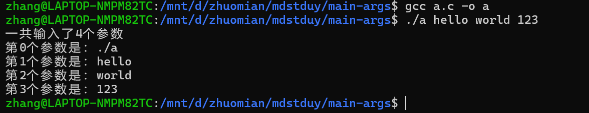
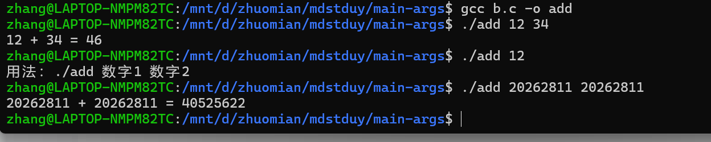
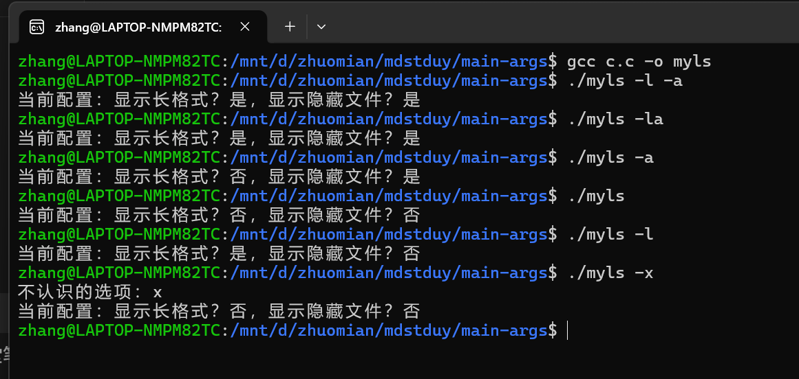
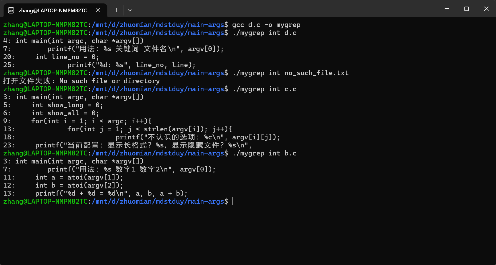
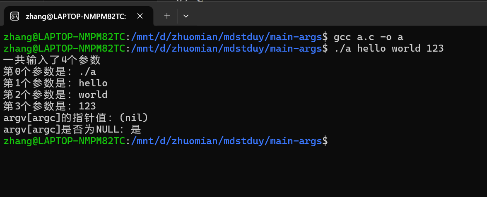
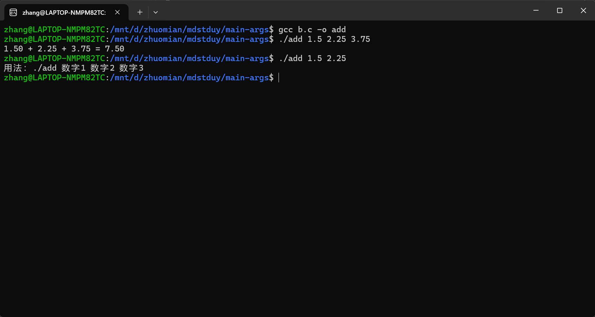
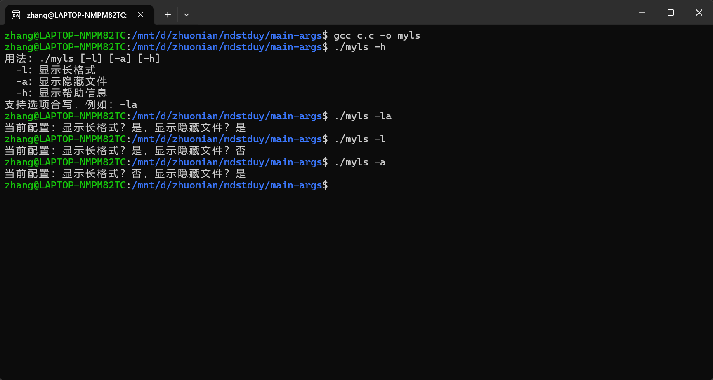
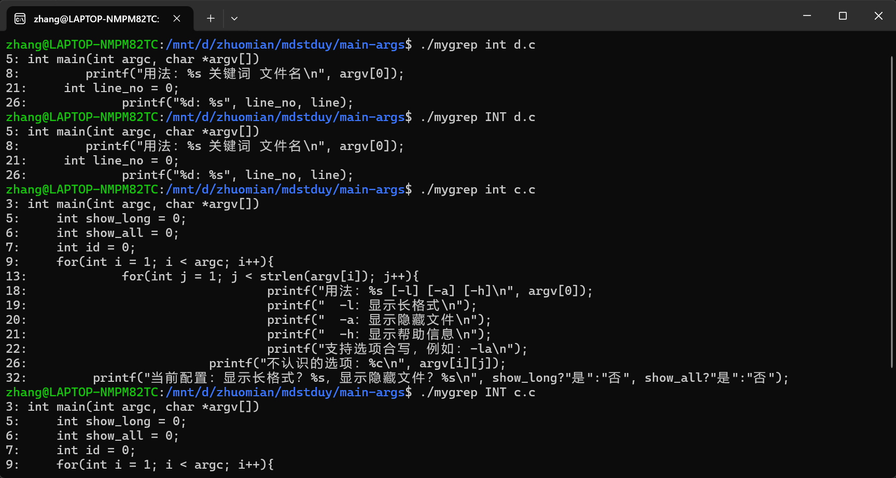

# 20262811《Linux内核原理与分析》main 参数

本次实验在WSL2的Ubuntu环境中使用GCC编译C程序，学习main函数的命令行参数，并完成四个基础示例和四项扩展练习。

## 一、为什么需要学习main函数参数

命令行参数可以在启动程序时传入数据，使同一个程序适应不同的输入。例如，复制文件时可以输入：

```bash
./mycopy a.txt b.txt
```

程序通过main函数获取源文件和目标文件的路径。这样就可以通过改变参数控制程序的行为，减少修改源码和重新编译的次数。

## 二、两个核心参数：argc和argv

接收命令行参数的main函数可以写成：

```c
int main(int argc, char *argv[])
```

`argc`是argument count，表示传入的参数总数；通常也包含程序启动时使用的名称。`argv`是argument vector，可以理解为参数列表，其元素是指向各个参数字符串的指针。

例如运行`./add 12 34`时，参数关系如下：

| 项目 | 内容 | 含义 |
| --- | --- | --- |
| `argc` | `3` | 包括程序名在内，共有三个参数 |
| `argv[0]` | `"./add"` | 程序启动时使用的名称 |
| `argv[1]` | `"12"` | 第一个输入参数，类型仍然是字符串 |
| `argv[2]` | `"34"` | 第二个输入参数，类型仍然是字符串 |
| `argv[3]` | `NULL` | 即`argv[argc]`，表示参数列表结束 |

`argv[argc]`这个空指针不计入`argc`。在函数参数声明中，`char *argv[]`会调整为`char **argv`，两种写法都可以用于接收命令行参数。

## 三、参数处理的难点和常见问题

| 问题 | 理解与处理方法 |
| --- | --- |
| 参数的存储方式 | `argv`中的元素保存字符串的地址，使用`argv[i]`可以访问对应参数。 |
| 输入数字的类型 | 输入`12`，获得的仍然是字符串`"12"`，计算前需要进行类型转换。 |
| 参数个数检查 | 使用参数前先检查`argc`。两个数字相加需要`argc == 3`，三个数字相加需要`argc == 4`。 |
| 带空格的参数 | Shell会处理引号。例如`./a "hello world"`中，`hello world`整体作为一个参数传入，`argc`为2。 |
| 中文输出乱码 | 源文件编码与终端编码应匹配。本次将源文件保存为UTF-8后，中文输出恢复正常。 |

参数个数正确，也不代表输入内容一定合法。本次按练习要求使用`atoi()`和`atof()`，假设输入的是合法数字；需要严格检查转换错误时，可以使用`strtol()`、`strtod()`等函数。

## 四、由浅入深的四个基础示例

### 4.1打印所有输入参数

基础版本的`a.c`如下：

```c
#include <stdio.h>

int main(int argc, char *argv[])
{
    int i;
    printf("一共输入了%d个参数\n", argc);
    for (i = 0; i < argc; i++) {
        printf("第%d个参数是：%s\n", i, argv[i]);
    }
    return 0;
}
```

编译并运行：

```bash
gcc a.c -o a
./a hello world 123
```



输出显示共有4个参数，其中`argv[0]`是`./a`，其余三个分别是`hello`、`world`和`123`。程序通过循环逐个输出参数，使我直观看到了`argc`和`argv`之间的关系。

### 4.2两个整数相加

基础版本的`b.c`如下：

```c
#include <stdio.h>
#include <stdlib.h>

int main(int argc, char *argv[])
{
    if (argc != 3) {
        printf("用法：%s 数字1 数字2\n", argv[0]);
        return 1;
    }

    int a = atoi(argv[1]);
    int b = atoi(argv[2]);
    printf("%d + %d = %d\n", a, b, a + b);
    return 0;
}
```

编译并测试正常输入和参数不足的情况：

```bash
gcc b.c -o add
./add 12 34
./add 12
./add 20262811 20262811
```



程序先检查参数个数，再通过`atoi()`把字符串转换成整数。正常输入时得到`12 + 34 = 46`；只输入一个数字时显示用法提示。两个学号相加得到`40525622`，也与计算结果一致。

### 4.3解析带选项的命令

基础版本的`c.c`如下：

```c
#include <stdio.h>
#include <string.h>

int main(int argc, char *argv[])
{
    int show_long = 0;
    int show_all = 0;

    for (int i = 1; i < argc; i++) {
        if (argv[i][0] == '-') {
            for (int j = 1; j < strlen(argv[i]); j++) {
                switch (argv[i][j]) {
                    case 'l': show_long = 1; break;
                    case 'a': show_all = 1; break;
                    default:
                        printf("不认识的选项：%c\n", argv[i][j]);
                }
            }
        }
    }

    printf("当前配置：显示长格式？%s，显示隐藏文件？%s\n",
           show_long ? "是" : "否", show_all ? "是" : "否");
    return 0;
}
```

编译并测试不同选项：

```bash
gcc c.c -o myls
./myls -l -a
./myls -la
./myls -a
./myls
./myls -l
./myls -x
```



程序从`argv[1]`开始遍历，跳过程序名。对于以`-`开头的参数，再逐个判断其中的选项字符，因此`-l -a`和`-la`都可以启用两个标记。不传选项时两个标记都是0，输入`-x`时会提示未知选项。这个示例模拟的是选项解析，输出的是配置状态。

### 4.4搜索文件中包含关键词的行

基础版本的`d.c`如下：

```c
#include <stdio.h>
#include <string.h>
#define MAX_LINE 1024

int main(int argc, char *argv[])
{
    if (argc != 3) {
        printf("用法：%s 关键词 文件名\n", argv[0]);
        return 1;
    }
    char *keyword = argv[1];
    char *filename = argv[2];

    FILE *fp = fopen(filename, "r");
    if (fp == NULL) {
        perror("打开文件失败");
        return 1;
    }

    char line[MAX_LINE];
    int line_no = 0;
    while (fgets(line, MAX_LINE, fp) != NULL) {
        line_no++;
        if (strstr(line, keyword) != NULL) {
            printf("%d: %s", line_no, line);
        }
    }
    fclose(fp);
    return 0;
}
```

编译并测试多个文件及文件不存在的情况：

```bash
gcc d.c -o mygrep
./mygrep int d.c
./mygrep int no_such_file.txt
./mygrep int c.c
./mygrep int b.c
```



程序从命令行获取关键词和文件名，用`fopen()`打开文件，通过`fgets()`读取文本，再用`strstr()`判断是否包含关键词。匹配成功时输出行号和原文，文件不存在时显示打开失败的提示。

搜索`int`时，包含`printf`的行也会被输出，因为`printf`中含有子串`int`。这说明程序匹配的是字符串，而不是识别C语言关键字。本例使用固定长度缓冲区，适用于本次测试的短行文本；较长行可能被分段读取，需要进一步完善。

## 五、简化的认知框架

我对main函数参数的理解是：**argc记录个数，argv提供字符串指针；使用前检查个数，需要计算时再转换类型。**

程序的处理过程可以概括为：获取参数、检查输入、解析字符串、执行功能、输出结果。四个示例分别展示了参数遍历、数值转换、选项解析和文件搜索。

## 六、这个思路可以迁移到哪里

Python、Java、Go等语言也提供获取命令行参数的方式。虽然具体接口以及是否包含程序名可能不同，但读取输入、检查合法性、转换类型并执行功能的思路是相通的。

这个思路也可以迁移到后端请求参数处理：接收外部输入后，先检查是否满足要求，再将其转换为程序需要的数据类型。通过本次实验，我认识到参数检查和类型转换是连接外部输入与程序功能的重要环节。

## 七、具体可操作的下一步行动：四项扩展练习

### 7.1检查argv[argc]是否为空指针

在`a.c`的参数遍历结束后、`return 0;`之前增加：

```c
printf("argv[argc]的指针值：%p\n", (void *)argv[argc]);
printf("argv[argc]是否为NULL：%s\n",
       argv[argc] == NULL ? "是" : "否");
```

重新编译运行：

```bash
gcc a.c -o a
./a hello world 123
```



实际输出为`(nil)`，判断结果为“是”，验证了`argv[argc] == NULL`。`%p`用于输出指针值，传入时转换为`void *`；不能用`%s`把这个空指针作为字符串打印。

### 7.2改为三个浮点数相加

将`b.c`修改为：

```c
#include <stdio.h>
#include <stdlib.h>

int main(int argc, char *argv[])
{
    if (argc != 4) {
        printf("用法：%s 数字1 数字2 数字3\n", argv[0]);
        return 1;
    }

    double a = atof(argv[1]);
    double b = atof(argv[2]);
    double c = atof(argv[3]);

    printf("%.2f + %.2f + %.2f = %.2f\n",
           a, b, c, a + b + c);
    return 0;
}
```

重新编译运行：

```bash
gcc b.c -o add
./add 1.5 2.25 3.75
./add 1.5 2.25
```



增加第三个数字后，所需参数总数变为4。程序使用`atof()`把三个字符串转换成`double`，再通过`%.2f`显示两位小数。正常输入得到`1.50 + 2.25 + 3.75 = 7.50`，输入不足时仍然提示用法。

### 7.3增加-h选项，打印帮助信息

在`c.c`中增加标记变量`int id = 0;`，并在`switch`中加入帮助分支：

```c
case 'h':
    printf("用法：%s [-l] [-a] [-h]\n", argv[0]);
    printf("  -l：显示长格式\n");
    printf("  -a：显示隐藏文件\n");
    printf("  -h：显示帮助信息\n");
    printf("支持选项合写，例如：-la\n");
    id = 1;
    break;
```

最后的配置输出由`id`控制：

```c
if (id == 0) {
    printf("当前配置：显示长格式？%s，显示隐藏文件？%s\n",
           show_long ? "是" : "否", show_all ? "是" : "否");
}
```

重新编译运行：

```bash
gcc c.c -o myls
./myls -h
./myls -la
./myls -l
./myls -a
```



输入`-h`时，程序打印帮助并将`id`设为1，因此最后不会再输出“当前配置”。这里的`break`只退出当前`switch`，程序仍会继续处理后面的参数；最终是否显示配置，由`id`决定。没有帮助选项时，原有的`-l`、`-a`和`-la`功能保持正常。

### 7.4改为不区分英文大小写匹配

在`d.c`的所有`#include`之前增加：

```c
#define _GNU_SOURCE
```

将原来的`strstr()`改为`strcasestr()`：

```c
// strcasestr忽略英文大小写，判断行里有没有关键词
if (strcasestr(line, keyword) != NULL) {
    printf("%d: %s", line_no, line);
}
```

`strcasestr()`是GNU扩展，本次在Ubuntu环境中使用。先重新编译，再用小写和大写关键词测试：

```bash
gcc d.c -o mygrep
./mygrep int d.c
./mygrep INT d.c
./mygrep int c.c
./mygrep INT c.c
```



截图上方对`d.c`的两次搜索结果完全相同，均匹配第5、8、21和26行，证明`int`与`INT`能够找到相同的内容。程序改变的是匹配规则，输出仍然保留文件原文的大小写。

通过四项扩展，我进一步理解了参数列表的结束标记、字符串到浮点数的转换、帮助选项的控制逻辑，以及字符串匹配规则的调整。命令行参数让程序能够根据不同输入完成不同操作，而检查参数和正确解析输入是实现这些功能的基础。
